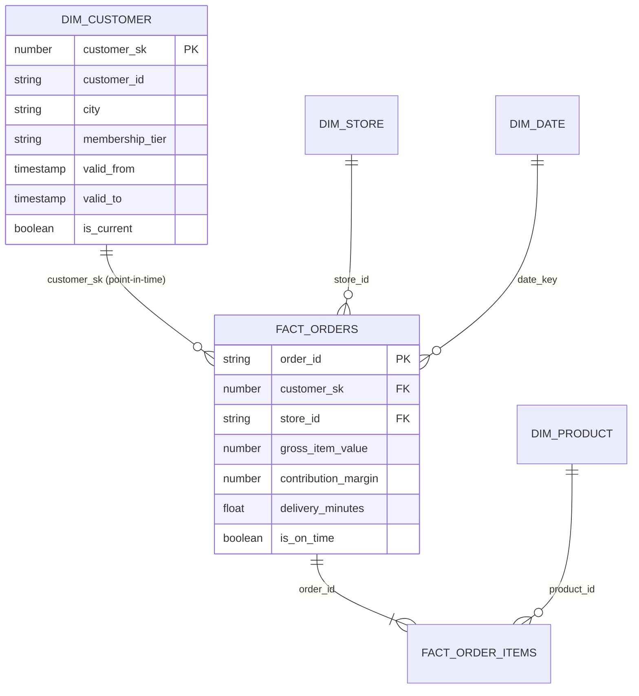
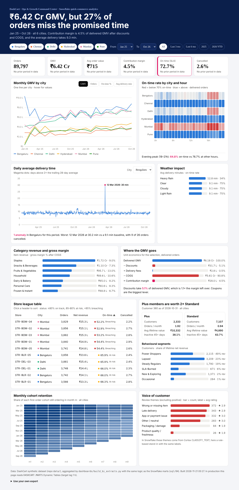

# ❄️ DashCart: Quick-Commerce Analytics on Snowflake

**An end-to-end, production-style analytics platform for a 10-minute grocery delivery business, built entirely on Snowflake.**

The project covers CDC pipelines, SCD Type 2, dynamic tables, semi-structured JSON, governance, data quality, in-database ML with Cortex, LLM enrichment, Snowpark Python and a Streamlit-in-Snowflake dashboard. The data stays inside Snowflake the whole way through.

> DashCart is a fictional company. All data is synthetic, generated by `data_generator/generate_data.py`: 24 dark stores in 6 Indian cities, 12k customers, ~90k orders, ~305k order lines, ~250k app events and ~10k reviews, covering Jan 2025 to Oct 2026.

---

## 1. Business problem

DashCart promises delivery in 10–15 minutes. Leadership wants one trusted platform that answers these questions:

| Stakeholder | Question | Where it's answered |
|---|---|---|
| CEO / Finance | Are we growing, and is each order profitable after discounts and COGS? | `DT_DAILY_CITY_KPIS`, Q7, Q8 |
| Ops head | Where and when do we break the 10-minute SLA? Did something go wrong today? | Q5, Q11, Cortex anomaly detection, `ALRT_SLA_SPIKE` |
| Growth | Which customers churn? Are coupons and the Plus membership worth it? | Q1, Q2, Q9, Q10, churn model |
| Category | What do people buy together? | Q3 market basket |
| CX | What are customers complaining about, per store? | Cortex SENTIMENT, CLASSIFY_TEXT, COMPLETE |
| Data Gov. | Is PII protected, and do city managers see only their own city? | Tag-based masking, row access policy |

## 2. Architecture

```mermaid
flowchart LR
  subgraph Sources
    A1[orders / items / customers CSV.gz]
    A2[delivery events NDJSON]
    A3[app clickstream NDJSON]
    A4[reviews CSV]
  end
  subgraph RAW["RAW (bronze)"]
    S[(Internal stage / S3 + Snowpipe)] --> R[RAW_* tables + VARIANT]
  end
  subgraph STAGING["STAGING (silver)"]
    V[typed + dedup views<br/>LATERAL FLATTEN]
  end
  subgraph CORE["CORE (gold star schema)"]
    D1[DIM_CUSTOMER SCD2]:::k
    D2[DIM_STORE / DIM_PRODUCT / DIM_DATE]
    F1[FACT_ORDERS]:::k
    F2[FACT_ORDER_ITEMS]
  end
  subgraph MARTS["MARTS"]
    DT[Dynamic Tables<br/>KPIs · store load · customer 360 · product]
  end
  subgraph ML["ML + AI"]
    M1[Cortex FORECAST]
    M2[Cortex ANOMALY_DETECTION]
    M3[Cortex CLASSIFICATION churn]
    M4[Cortex SENTIMENT · CLASSIFY_TEXT · COMPLETE]
    M5[Snowpark KMeans segments]
  end
  A1 & A2 & A3 & A4 --> S
  R -- Streams --> T{{Task DAG<br/>CRON hourly}}
  R --> V --> T --> CORE --> DT
  DT --> ML
  DT & ML --> APP[Streamlit in Snowflake<br/>Command Center]
  T -. FINALIZE .-> DQ[DQ checks + DMFs → Alerts]
  classDef k fill:#29B5E8,color:#fff
```



**Task DAG (hourly, runs only when a stream has new data):**

```
T00_ROOT ─► T10_TYPE1_DIMS ─┬─► T20_DIM_CUSTOMER_SCD2 ─┐
                            └─► T30_FACT_ORDER_ITEMS ──┴─► T40_FACT_ORDERS ─► T50_PATCH_LATE_DELIVERIES
T99_FINALIZE_DQ  (FINALIZE task, always runs after the graph, success or failure)
```

## 3. Snowflake features used

| Area | Feature | File |
|---|---|---|
| Platform | RBAC role hierarchy, managed-access schemas, workload-isolated warehouses, multi-cluster BI warehouse, resource monitor, statement timeout | `00_setup_account.sql` |
| Ingestion | File formats, internal stage + directory table, `COPY INTO` with load metadata, `VALIDATION_MODE`, `ON_ERROR` strategies, `COPY_HISTORY` audit, Snowpipe auto-ingest template (S3 + storage integration) | `01_ingestion_raw.sql` |
| Semi-structured | `VARIANT`, dot-path access, `LATERAL FLATTEN`, pivoting event arrays into milestones | `02_staging_views.sql` |
| CDC & modelling | Append-only **Streams** (`SHOW_INITIAL_ROWS`), **SCD Type 2** in a transactional Snowflake Scripting procedure, `MERGE`, point-in-time joins, late-arriving data patching, `GENERATOR` date dimension, clustering key | `03_core_model_cdc.sql` |
| Orchestration | **Task DAG** with CRON, `WHEN SYSTEM$STREAM_HAS_DATA`, multi-predecessor `AFTER`, **FINALIZE** task, `TASK_HISTORY` | `03`, `08` |
| Declarative pipelines | **Dynamic Tables** (`TARGET_LAG`, `DOWNSTREAM`, incremental refresh), refresh history | `04_marts_dynamic_tables.sql` |
| Advanced SQL | Cohorts with `PIVOT`, RFM with `NTILE`, market basket (support/confidence/lift), **`MATCH_RECOGNIZE`**, `QUALIFY`, `RANGE` window frames, `UNPIVOT`, `RATIO_TO_REPORT`, difference-in-differences, Pareto, gap-filling | `05_advanced_analytics.sql` |
| ML | **Cortex ML** `FORECAST` (multi-series), `ANOMALY_DETECTION`, `CLASSIFICATION` (with evaluation metrics and feature importance) | `06_cortex_ml_ai.sql` |
| GenAI | **Cortex AI** `SENTIMENT`, `CLASSIFY_TEXT`, `COMPLETE` (LLM store-manager briefs) | `06_cortex_ml_ai.sql` |
| Governance | Tags, **tag-based masking** driven by tag value, **row access policy** with a mapping table, secure view, Secure Data Sharing, `ACCESS_HISTORY` audit | `07_governance_security.sql` |
| Resilience | **Time Travel** (`AT`), `UNDROP`, **zero-copy clone** of the whole database for DEV | `07_governance_security.sql` |
| Data quality | **Data Metric Functions** (system + custom), rule-based DQ procedure, **Alerts** + email | `08_data_quality_alerts.sql` |
| Performance & FinOps | Clustering info, pruning analysis, search optimization, result cache, credits by warehouse/service, cost attribution by `QUERY_TAG`, spilling, storage incl. Time Travel | `09_performance_cost.sql` |
| Python | **Snowpark** DataFrame API, stored procedure (scikit-learn KMeans with silhouette-based k), vectorized UDF | `snowpark/` |
| App | **Streamlit in Snowflake** with 5 tabs, deployed via SQL or Snow CLI | `streamlit/`, `10_streamlit_app.sql` |

## 4. Data model



## 5. Key findings

These numbers come from the committed dataset. `tests/local_reference_check.py` reproduces them offline, and the SQL in Snowflake should return the same values.

| Theme | Finding |
|---|---|
| Scale | 89,797 orders · **₹6.42 Cr GMV** · AOV **₹715** |
| Unit economics | Contribution margin is only **~4.5% of GMV** after discounts and COGS. Discounts are the biggest lever (Q8, Q9). |
| SLA | **72.7%** of orders arrive on time. The evening peak (18–21h) is the worst window, at ~65% vs ~75% at other hours (Q5). |
| Monsoon | Mumbai's late rate goes from 34% to 67% in Jun–Sep while other metros stay flat. That is a **+34 pp difference-in-differences** effect (Q11), which makes the case for monsoon-specific promised times. |
| Incident | **Bengaluru, 12 Mar 2026**: average delivery jumps from ~9 to **30 min** and 35% of orders are cancelled. Cortex anomaly detection flags it with no rules written. |
| Festivals | Diwali 2025 demand is **+116%** vs the same weekday baseline, and on-time performance drops to **51%** in Diwali week (Q6). |
| Membership | Plus members order **2.0×** as often (1.92 vs 0.94 orders/month), have **2.1×** the LTV, and churn far less (38% vs 64% inactive for 45+ days) (Q10). |
| Concentration | **33%** of customers generate 80% of net revenue (Q13). |
| Segments | Snowpark KMeans (k=5 by silhouette) finds Power Shoppers, Steady Regulars, SLA-Burned, Lapsed and New & Exploring. "SLA-Burned" is a retention target that is easy to act on. |

## 6. Run it

**Prerequisites:** a Snowflake account (the [30-day trial](https://signup.snowflake.com/) is enough) on **Enterprise edition** or higher (needed for masking, row access policies, DMFs, multi-cluster warehouses and search optimization; trial accounts are Enterprise). Cortex functions must be available in your region. If they aren't, enable cross-region inference with `ALTER ACCOUNT SET CORTEX_ENABLED_CROSS_REGION = 'ANY_REGION';` as ACCOUNTADMIN. Python 3.10+.

### Option A: one command

```bash
pip install -r requirements.txt
snow connection add                 # name: dashcart, use a user with ACCOUNTADMIN
bash scripts/deploy.sh
```

### Option B: step by step in Snowsight worksheets

1. `python data_generator/generate_data.py` (or use the committed `data/`)
2. Run `sql/00_setup_account.sql` as ACCOUNTADMIN
3. Upload the files to the stage that `00` created: Snowsight → Data → DASHCART → RAW → Stages → `LANDING` → **+ Files** (path `dashcart/`), or run `PUT file://data/*.gz @DASHCART.RAW.LANDING/dashcart/ AUTO_COMPRESS=FALSE;`
4. Run `01` → `02` → `03` → `04` → `06` → `07` → `08` in order
5. `python snowpark/deploy.py` (customer segments + UDF)
6. `sql/10_streamlit_app.sql` (dashboard)
7. Explore `sql/05_advanced_analytics.sql` and `sql/09_performance_cost.sql`

**SCD Type 2 demo:** at the end of `03_core_model_cdc.sql`, load `customer_updates.csv.gz` (720 customers change city or tier), run the DAG, and watch history rows appear. Q14 in `05` then compares revenue by tier *at order time* against tier *now*.

**Cost:** the full build uses a few credits on XS/S warehouses. Every warehouse auto-suspends after 60s, and the resource monitor caps spend. Suspend `T00_ROOT` and the alerts when you're done.

## 6b. Dashboards (Power BI · Tableau · Live)

`dashboards/` turns the marts into three front-ends that show the same numbers: a Power BI report kit (Power Query for CSV or Snowflake DirectQuery, 70 DAX measures, theme), a Tableau kit (calculated fields, palettes, a 4-dashboard story) and a **live dashboard** (Streamlit app reading Snowflake, plus a zero-install HTML version). Start with `python dashboards/build_bi_extracts.py`. See [`dashboards/README.md`](dashboards/README.md).



## 7. Repository layout

```
├── data/                      synthetic data (gzip CSV + NDJSON)
├── data_generator/            reproducible generator (seeded, patterns injected on purpose)
├── sql/
│   ├── 00_setup_account.sql   roles, warehouses, resource monitor, schemas
│   ├── 01_ingestion_raw.sql   stage, file formats, COPY, Snowpipe template
│   ├── 02_staging_views.sql   typing, dedup, JSON flattening
│   ├── 03_core_model_cdc.sql  star schema, streams, SCD2, MERGE, task DAG
│   ├── 04_marts_dynamic_tables.sql
│   ├── 05_advanced_analytics.sql   14 business questions
│   ├── 06_cortex_ml_ai.sql    forecast, anomaly, churn, sentiment, LLM
│   ├── 07_governance_security.sql
│   ├── 08_data_quality_alerts.sql
│   ├── 09_performance_cost.sql
│   └── 10_streamlit_app.sql
├── snowpark/                  KMeans stored procedure, vectorized UDF, deploy script
├── streamlit/                 Streamlit-in-Snowflake app
├── dashboards/                Power BI kit · Tableau kit · live dashboard (Streamlit + HTML)
├── tests/local_reference_check.py   offline pandas reference + Snowpark handler test
├── scripts/deploy.sh          Snow CLI one-shot deploy
└── snowflake.yml              Snow CLI project definition
```

## 8. Design decisions

- **RAW is all strings.** Loads never fail on a bad value. Typing happens in STAGING with `TRY_TO_*`, so bad values become NULL and show up in DQ checks instead of breaking the load.
- **Streams + Tasks for the core, Dynamic Tables for marts.** The core needs procedural logic (SCD2, late-arriving data). Marts are pure aggregations, where declarative and incremental refresh is simpler and cheaper.
- **The SCD2 procedure runs in one transaction with a DML work table.** The stream offset only advances on commit, so a failure never loses changes.
- **Point-in-time customer key on the fact.** Revenue is attributed to the tier and city the customer had *when they ordered*.
- **Engineers see clear-text PII.** The pipeline runs as `DASHCART_ENGINEER`, so masking for that role would write masked values into CORE. This is a common pitfall. Analysts and city managers get masked values.
- **Churn labels avoid leakage.** Features are computed strictly before the 2026-09-01 cut-off, and the label covers the 60 days after it.

## 9. Possible extensions

dbt-snowflake models on top of STAGING · Iceberg tables for open-format sharing · Snowflake Native App packaging · Cortex Analyst semantic model for natural-language questions · CI deploy to `DASHCART_DEV` clone with GitHub Actions + Snow CLI.

---

**Author:** Dharmesh Kumar · [GitHub](https://github.com/Dharmeshkumar2327) · [LinkedIn](https://www.linkedin.com/in/dharmesh-kumar-293a89235)
