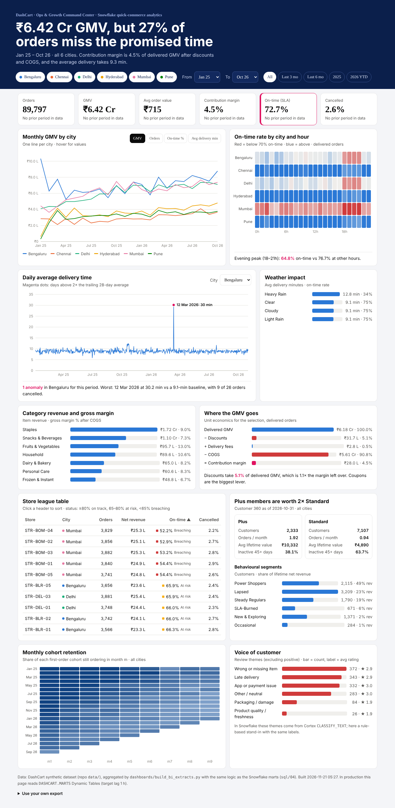

# 📊 DashCart Dashboards: Power BI · Tableau · Live

Three ways to present the DashCart Snowflake platform. All three use **the same numbers** as the SQL marts and `tests/local_reference_check.py`.



```
dashboards/
├── build_bi_extracts.py      ← run first: star schema + marts → data/*.csv + dashboard_data.json
├── data/                     ← generated extracts (14 files)
├── powerbi/                  ← Power Query (CSV + Snowflake), 70 DAX measures, theme, page-by-page guide
├── tableau/                  ← calculated fields, colour palettes (.tps), 16-sheet / 4-dashboard guide + story
└── live/
    ├── index.html            ← zero-install interactive dashboard (filters, hover, dark mode)
    ├── dashboard_data.json
    ├── streamlit_app.py      ← deployable app: LIVE from Snowflake or DEMO from CSVs
    ├── requirements.txt
    └── secrets.toml.example
```

## Quick start

```bash
python dashboards/build_bi_extracts.py          # ~10 s, prints the headline KPIs as a check
streamlit run dashboards/live/streamlit_app.py  # live app (DEMO mode without secrets)
```

| Check (all data) | Value |
|---|---|
| Orders | 89,797 |
| GMV | ₹6.42 Cr |
| AOV | ₹715 |
| Contribution margin | 4.5% of delivered GMV |
| On-time rate | 72.7% (evening peak 64.8%) |
| Mumbai monsoon DiD | +34.1 pp |
| Bengaluru 12 Mar 2026 | 30.2 min avg delivery, 9 of 26 orders cancelled |
| Plus vs Standard | 1.92 vs 0.94 orders/month · ₹10,332 vs ₹4,890 LTV · 38% vs 64% inactive 45d |

## Which dashboard for what

| | Power BI | Tableau | Live (Streamlit / HTML) |
|---|---|---|---|
| Audience | Leadership, finance | Storytelling, Tableau Public portfolio | Ops team, anyone with a link |
| Snowflake | DirectQuery on `CORE` facts + import marts | Live connection to `MARTS.DT_ORDERS_ENRICHED` | `st.connection("snowflake")`, 10-min cache |
| Freshness | Every interaction (DQ) / scheduled refresh | Live or extract | Dynamic Tables lag ≤ 1 h + refresh button |
| Governance | `DASHCART_ANALYST` role → masked PII, row access policy | same | same |
| Public link | Publish to web | Tableau Public | Streamlit Community Cloud |

## Pages / views in all three

1. **Executive:** GMV, orders, AOV, CM%, SLA, cancellations; city trend; unit-economics bridge; category mix
2. **Delivery SLA:** city × hour on-time heatmap; daily delivery time with anomaly flags; weather; store league table
3. **Events:** Mumbai monsoon DiD, Diwali uplift (Power BI page 3 / Tableau D3)
4. **Customers:** Plus vs Standard, RFM segments, cohort retention, Pareto
5. **Voice of customer:** complaint themes (Cortex CLASSIFY_TEXT in Snowflake)

## Deploy the live app (free)

1. Push the repo, including `dashboards/data/` (≈ 75 MB, under GitHub's 100 MB per-file limit).
2. [share.streamlit.io](https://share.streamlit.io) → *New app* → main file `dashboards/live/streamlit_app.py`.
3. For **LIVE** mode, paste `secrets.toml.example` (filled in) into *Settings → Secrets*. Use a read-only user with role `DASHCART_ANALYST`, and keep the `DASHCART_BI_WH` auto-suspend at 60 s so it costs almost nothing.
4. Put the URL in the main README and on LinkedIn.

The static `live/index.html` + `dashboard_data.json` can also be hosted free on **GitHub Pages** (Settings → Pages → `/dashboards/live`).

## Design rules (shared across tools)

Each city keeps the same colour in every tool: Bengaluru `#2a78d6` · Chennai `#eb6834` · Delhi `#1baf7a` · Hyderabad `#eda100` · Mumbai `#e87ba4` · Pune `#008300`. The palette was checked for colour-blind separation. Green, amber and red are used only for SLA status, always with a text label. Every chart has a single y-axis.
